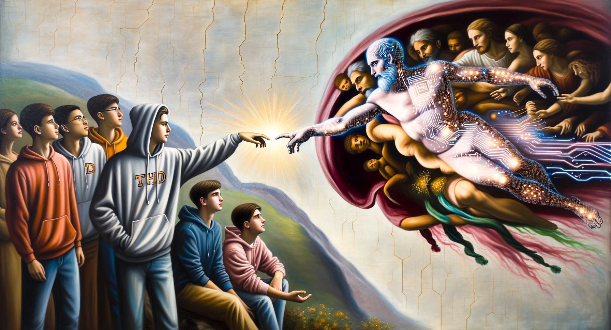

# THD AI – 2023–2024 public archive

The first version of this community began as a space for the 2023 English-taught AI cohort. These documents and illustrations are preserved as history, not current guidance. The organization became **THD AI** in October 2026 to welcome students across cohorts.

## Original documents

- [Original public profile](profile/README.md)
- [Original root README](original-root-README.md)
- [Original contribution guide](CONTRIBUTING.md)

## Original visuals

### Public profile

### Community hub

### Winter semester 2024/25 announcement

### Calendar release artwork

### Organization avatar

The earlier `random_iceberg.png` is also retained here. The original source was supplied by Alexander in the organization repositories or their public attachments. Historical assets retain their original rights. They are not covered by the new banner's licence.

The archive discussion links to these committed copies so it does not depend on expiring attachment URLs. Member-only documents and artwork remain in `.github-private`.
