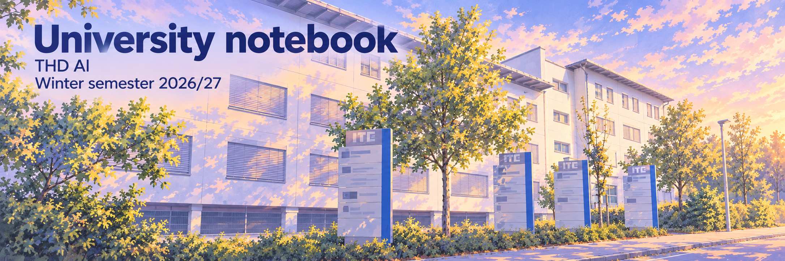
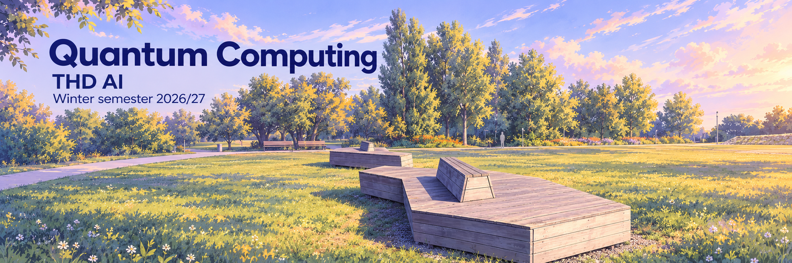
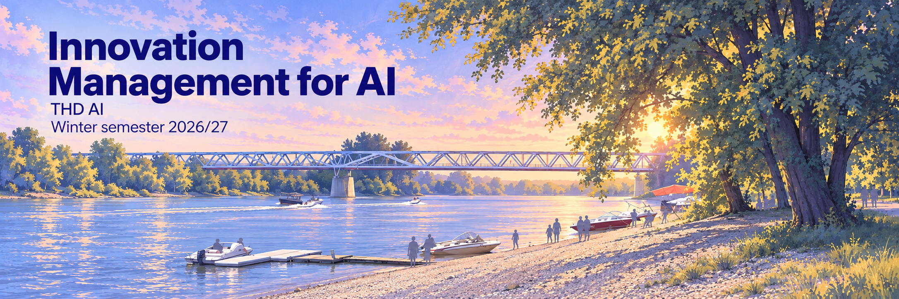
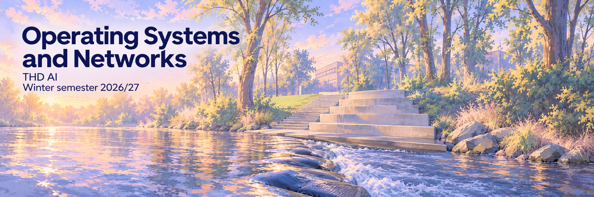
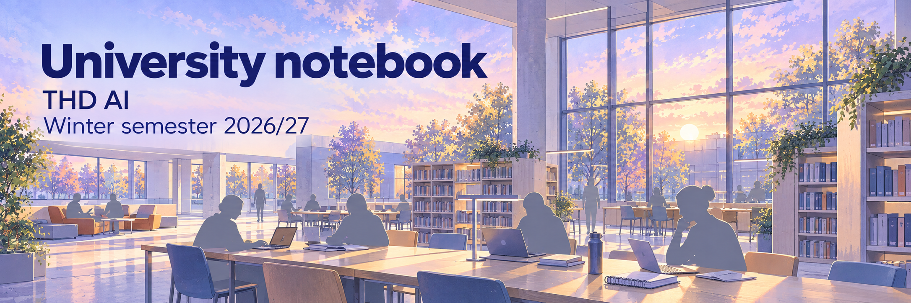
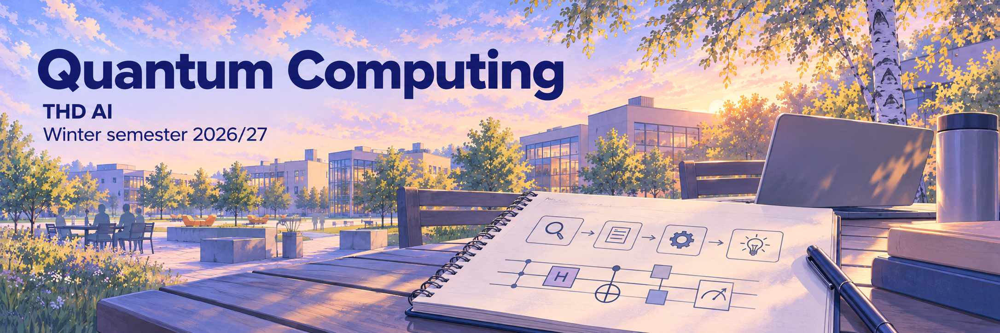
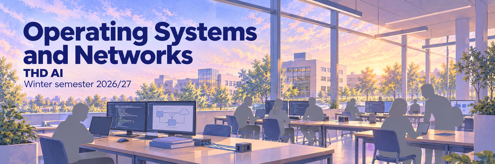

# WS27 study-notebook banners · November 2026

Alex's WS27 study notebook and three of its course pages use illustrated banners in the THD AI visual family. Each set is kept here so the history stays with the rest of the branding archive. These are decorative illustrations, not photographs, and they do not imply any university endorsement.

## Current set · 2 November 2026

Each banner repaints a real Deggendorf photograph in the THD AI style: lavender haze, dusty blue, peach light, muted sage and indigo lettering. The approved [public campus banner](https://github.com/THD-AI/.github/blob/main/assets/thd-ai-banner.png) supplied the style only.

| Banner | Location reference (Wikimedia Commons) | Photo licence |
| --- | --- | --- |
| University notebook | [ITC_2_Deggendorf.jpg](https://commons.wikimedia.org/wiki/File:ITC_2_Deggendorf.jpg), Danube-Waidler | CC BY-SA 4.0 |
| Quantum Computing | [Sitzmöbel_Donaupark_(Deggendorf)_(1).jpg](https://commons.wikimedia.org/wiki/File:Sitzmöbel_Donaupark_(Deggendorf)_(1).jpg), APneunzehn74 | CC0 1.0 |
| Innovation Management for AI | [Blick_vom_Deggendorfer_Stadtstrand_zum_Donausteg_flussaufwärts.jpg](https://commons.wikimedia.org/wiki/File:Blick_vom_Deggendorfer_Stadtstrand_zum_Donausteg_flussaufwärts.jpg), Danube-Waidler | CC BY-SA 4.0 |
| Operating Systems and Networks | [Trittsteine_durch_den_Bogenbach,_Kollbach_in_Deggendorf_2.jpg](https://commons.wikimedia.org/wiki/File:Trittsteine_durch_den_Bogenbach,_Kollbach_in_Deggendorf_2.jpg), APneunzehn74 | CC BY-SA 4.0 |

[sources.json](sources.json) holds the exact prompts, authors, capture dates, licences, dimensions and SHA-256 hashes. Its `output` paths point into Alex's private study workspace, where these files were first saved. The illustrated adaptations are shared under [CC BY-SA 4.0](https://creativecommons.org/licenses/by-sa/4.0/).

## First illustrated set · 1 November 2026

The first set showed generic study scenes rather than real places. It was replaced because the scenes were not grounded in Deggendorf locations.

A photo-panel variant tried on 2 November was rejected and is not part of this archive.
